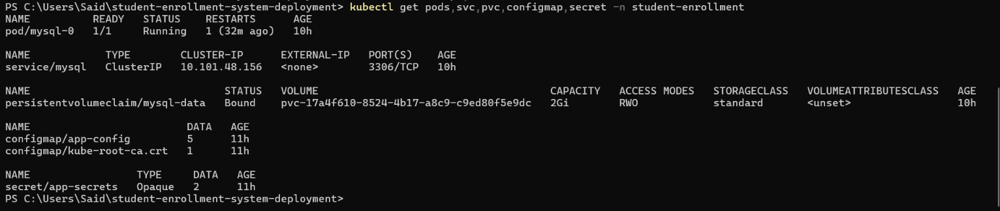
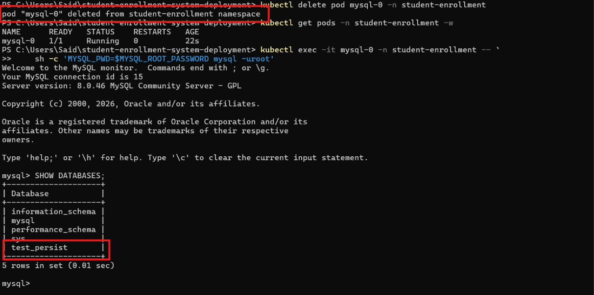

# Fondations Kubernetes (MySQL, ConfigMap, Secret) issue #6

## Objectif
Cette étape permet de préparer les fondations de l'infrastructure sur Kubernetes. Elle permet de fournir aux 6 services une base de données MySQL persistante, ainsi que leurs réglages (ConfigMap) et leurs mots de passe (Secret) sans les écrire en dur dans le code.

## Ce que j'ai fait
- **Namespace** : J'ai créé l'espace `student-enrollment` pour isoler toutes les ressources du projet.
- **ConfigMap** : J'ai créé `app-config` contenant le profil Spring (`k8s`) et les 4 URL de connexion aux bases de données pointant vers le service `mysql:3306`.
- **Secret** : J'ai préparé le fichier d'exemple `secret.yaml.example` et utilisé le script `create-secrets.ps1` pour générer de vrais mots de passe aléatoires (`DB_PASSWORD` et `JWT_SECRET`) directement dans le cluster, sans jamais les enregistrer dans Git.
- **MySQL (PVC, StatefulSet, Service)** : 
  - J'ai créé un **PVC** de 2 Go pour garantir la persistance des données.
  - J'ai déployé un **StatefulSet** MySQL 8.0 qui utilise le Secret pour le mot de passe root et le PVC pour le stockage.
  - J'ai créé un **Service** (ClusterIP) nommé `mysql` sur le port `3306` pour exposer la base aux autres pods.

## Commandes principales
- `minikube start` : Démarre le cluster local.
- `kubectl apply -f k8s/00-namespace.yaml` : Crée le namespace.
- `powershell -ExecutionPolicy Bypass -File .\scripts\create-secrets.ps1` : Lance le script qui génère les secrets de manière sécurisée.
- `kubectl apply -f k8s/config/configmap.yaml` : Applique la ConfigMap.
- `kubectl apply -f k8s/mysql/` : Déploie le PVC, le StatefulSet et le Service MySQL.
- `kubectl get pods -n student-enrollment -w` : Permet de suivre en direct le démarrage du pod `mysql-0`.
- `kubectl delete pod mysql-0 -n student-enrollment` : Test de résilience pour vérifier que le StatefulSet recrée le pod.
- `kubectl run mysql-client ...` : Lance un pod temporaire pour tester la connexion réseau au nom `mysql`.

## Preuve que ça marche

*(Capture montrant mysql-0 en 1/1 Running, le PVC Bound et le Service)*

*(Capture du Test A montrant test_persist après suppression du pod)*

## Erreurs rencontrées
| Erreur | Cause | Solution |
|---|---|---|
| `connection refused` (Minikube) | Docker Desktop ou Minikube avait été redémarré. | Relancer `minikube start` et vérifier avec `kubectl get nodes`. |
| `ERROR 1045 (28000): Access denied` (Test B) | Le mot de passe collé manuellement après décodage base64 était mal interprété par le terminal. | Utiliser la variable d'environnement `MYSQL_PWD=$pw` dans la commande `kubectl run` au lieu de l'option `-p`. |

## Ce que j'ai appris
- **StatefulSet vs Deployment** : Un StatefulSet garantit que le pod garde le même nom (`mysql-0`) et retrouve le même disque (PVC) après un redémarrage, contrairement à un Deployment classique.
- **Persistance** : La suppression d'un pod ne supprime pas les données si elles sont stockées sur un PVC. J'ai prouvé que `test_persist` a survécu à la suppression du pod.
- **Secret** : Les données d'un Secret sont encodées en Base64, ce qui n'est **pas du chiffrement**. C'est pour cela qu'il ne faut jamais mettre de vrais mots de passe dans un dépôt Git public.
- **Réseau Kubernetes** : Grâce au Service, n'importe quel pod du namespace peut joindre la base de données simplement en utilisant le nom `mysql` (DNS interne de Kubernetes).
