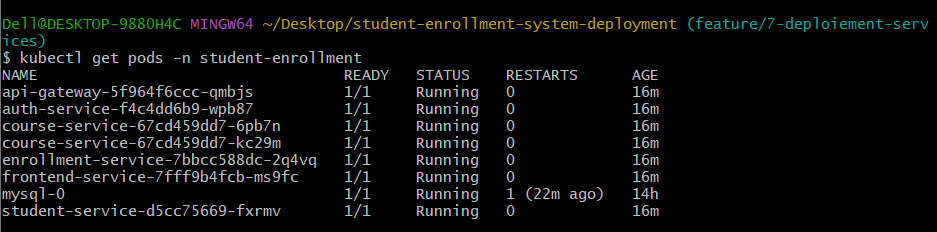

# Déploiement des 6 services avec sondes de santé (issue #7)

## Objectif
Déployer api-gateway, student-service, course-service, enrollment-service, frontend-service et auth-service sur Minikube, avec leur configuration (ConfigMap, Secret) et trois sondes de santé par service.

## Ce que j'ai fait
- **Images** : construites en local avec `docker build` puis chargées dans Minikube avec `minikube image load`. J'ai utilisé `imagePullPolicy: IfNotPresent` pour que Kubernetes utilise l'image locale au lieu d'essayer de la télécharger.
- **Un fichier par service** (`k8s/apps/<service>.yaml`) : un Deployment et un Service (ClusterIP) dont le nom et le port sont ceux du service (8080 à 8085).
- **Configuration** : `SPRING_PROFILES_ACTIVE` vient de `app-config` ; les 4 services avec base de données reçoivent `SPRING_DATASOURCE_URL` (depuis `app-config`) et `SPRING_DATASOURCE_PASSWORD` (depuis `app-secrets`, clé `DB_PASSWORD`) ; `JWT_SECRET` vient de `app-secrets` pour api-gateway et auth-service.
- **Sondes** : `startupProbe` (laisse 150 s à Spring Boot pour démarrer), puis `readinessProbe` (le pod est prêt à recevoir du trafic) et `livenessProbe` (le pod est redémarré s'il se bloque). Elles utilisent les endpoints Actuator ajoutés à l'issue #3.
- **Ressources** : requests 100m CPU et 256Mi, limite mémoire 512Mi.
- **Réplicas** : 2 pour `course-service`, 1 pour les autres.

## Commandes principales
- `docker build -t student-enrollment/<service>:dev services/<service>` : construit l'image.
- `minikube image load student-enrollment/<service>:dev` : la charge dans Minikube.
- `minikube image ls | grep student-enrollment` : vérifie que les 6 images sont présentes.
- `kubectl apply -f k8s/apps/` : crée les Deployments et les Services.
- `kubectl get pods -n student-enrollment -w` : suit le démarrage des pods.
- `kubectl describe pod <pod> -n student-enrollment` : explique un pod qui ne démarre pas.
- `kubectl logs <pod> -n student-enrollment` : affiche les logs de l'application.

## Preuve que ça marche

*(Capture de `kubectl get pods -n student-enrollment` : 8 pods (7 pods de services, dont 2 pour course-service, plus mysql-0), READY 1/1, STATUS Running)*

## Erreurs rencontrées
| Erreur | Cause | Solution |
|---|---|---|
| `Temporary failure in name resolution` pendant `docker build` | Le DNS de Docker Desktop ne pouvait pas joindre `repo.maven.apache.org` depuis les conteneurs. | Ajout de `"dns": ["192.168.188.246", "8.8.8.8"]` dans Docker Desktop > Settings > Docker Engine, puis redémarrage et nouveau build. |
| `Aucune connexion n'a pu être établie` (kubectl et `minikube image load`) | Minikube était arrêté après le redémarrage de Docker Desktop. | `minikube start`, vérification avec `kubectl get nodes`, puis rechargement des 6 images. |
| Namespace `student-enrollment` vide (`No resources found`) | Les fondations de l'issue #6 (MySQL, ConfigMap, Secret) n'existaient pas sur mon cluster Minikube local. | Recréation du namespace, du Secret (`create-secrets.ps1`), de la ConfigMap et de MySQL, avec `mysql:8.0` chargée au préalable dans Minikube. |

## Ce que j'ai appris
- **Les trois sondes** : la `startupProbe` laisse le temps à Spring Boot de démarrer sans que les autres sondes ne tuent le pod trop tôt ; ensuite, la `readinessProbe` décide si le pod reçoit du trafic et la `livenessProbe` décide s'il faut le redémarrer.
- **Minikube est local à chaque PC** : un namespace, un secret ou une image créés sur un cluster n'existent pas sur celui d'un collègue. Le dépôt contient les fichiers, mais chaque cluster doit être alimenté séparément.
- **Images locales** : une image construite avec Docker n'est pas visible par Minikube tant qu'on ne l'a pas chargée avec `minikube image load`. C'est pour cela qu'on utilise `imagePullPolicy: IfNotPresent`.
- **Réseau** : plusieurs erreurs venaient du réseau (DNS de Docker, Minikube sans Internet) et non du code. Lire le message d'erreur en entier a permis de trouver la vraie cause.
