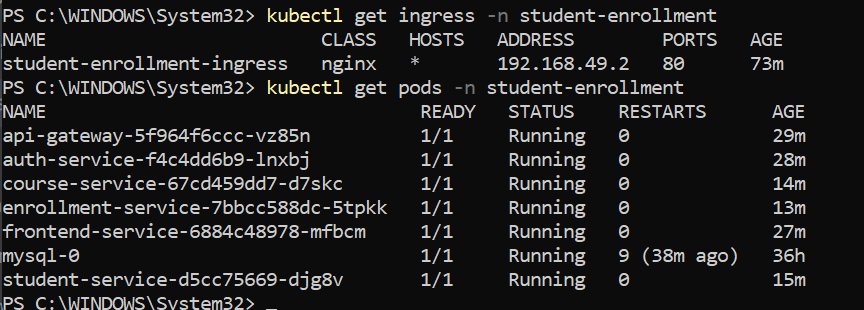

# Accès depuis le navigateur avec l'Ingress (issue #8)

## Objectif
Ouvrir l'application dans le navigateur à l'adresse `http://127.0.0.1`. L'Ingress est la porte d'entrée du cluster : il envoie `/auth`, `/students`, `/courses` et `/enrollments` vers `api-gateway` (port 8080), et `/` vers `frontend-service` (port 8084).

## Ce que j'ai fait
- **Addon Ingress** : activé avec `minikube addons enable ingress`. Le contrôleur NGINX tourne dans le namespace `ingress-nginx`.
- **`k8s/ingress.yaml`** : une seule ressource `student-enrollment-ingress` (classe `nginx`) avec 5 règles de type `Prefix`. Le chemin `/` est le plus court, donc NGINX choisit toujours les chemins plus précis (`/auth`, etc.) en premier.
- **`GATEWAY_URL` dans `k8s/apps/frontend-service.yaml`** : ajout de la variable `GATEWAY_URL=http://127.0.0.1`. Le navigateur appelle lui-même l'API, et la valeur par défaut (`http://localhost:8080`) n'existe pas dans ce montage. Avec cette valeur, la page et l'API ont la même origine.
- **Tunnel** : `minikube tunnel` dans un terminal PowerShell laissé ouvert, pour que l'Ingress soit joignable sur `127.0.0.1`.

## Commandes principales
- `minikube addons enable ingress` : installe le contrôleur d'Ingress.
- `kubectl get pods -n ingress-nginx` : vérifie que le contrôleur est `1/1 Running`.
- `kubectl apply -f k8s/ingress.yaml` : crée l'Ingress.
- `kubectl get ingress -n student-enrollment` : vérifie l'Ingress.
- `minikube tunnel` : rend l'Ingress accessible sur `127.0.0.1` (à laisser ouvert).
- `curl.exe -I http://127.0.0.1/` : teste la route `/`.

## Preuve que ça marche
- `curl.exe -I http://127.0.0.1/` répond `302` vers `/login`, et `/login` répond `200` : la route `/` arrive bien au frontend.
- `/students`, `/courses` et `/enrollments` sans jeton répondent `401` : la requête traverse l'Ingress et le filtre JWT de l'`api-gateway` la refuse, comme prévu.
- Scénario complet dans le navigateur : création d'un compte, connexion, affichage des cours, inscription à un cours. Dans l'onglet Network, toutes les requêtes (`/courses`, `/students/cnie/...`, `/enrollments`) répondent `200`.

*(L'application sur `127.0.0.1/home` : le cours est inscrit, avec le badge Enrolled)*

*(`kubectl get ingress` et `kubectl get pods` : l'Ingress existe et les pods sont Running)*

L'interface n'a pas de formulaire de création de cours : le cours « Cloud Computing » a été créé par l'API (`POST /courses` avec un jeton), en passant lui aussi par l'Ingress.

## Erreurs rencontrées
| Erreur | Cause | Solution |
|---|---|---|
| `minikube addons enable ingress` : `context deadline exceeded` | Minikube était arrêté, puis le téléchargement de l'image du contrôleur était très lent (près de 6 minutes). | `minikube start`, attendre que le contrôleur soit `1/1`, puis relancer la commande (qui est sans danger) : l'addon passe alors à `enabled`. |
| `kubectl` ne voyait pas le namespace `student-enrollment` | Le contexte actif était `kind-tp-k8s` (cluster d'un autre TP), pas `minikube`. | `kubectl config use-context minikube`, et vérifier avec `kubectl config current-context`. |
| `docker ps` : `500 Internal Server Error`, commandes très lentes, `minikube image load` bloqué | RAM saturée à 90-95 % (PC de 7,8 Go, Docker limité à 4 Go), disque C presque plein, et conteneurs inutiles (docker compose, cluster kind du TP) qui tournaient en même temps. | Disque de Docker déplacé sur un SSD externe (Settings > Resources > Advanced), conteneurs inutiles arrêtés, redémarrage de Docker avec `wsl --shutdown`. |
| Services en `CrashLoopBackOff`, RESTARTS qui augmentent | Les 6 services Spring Boot démarraient en même temps sur un nœud Minikube de 3,9 Go : la `startupProbe` expirait avant la fin du démarrage. | Tout mettre à 0 réplica avec `kubectl scale`, puis démarrer les services un par un avec `kubectl rollout status`. |
| Contrôleur Ingress qui redémarre (`Liveness probe failed ... Client.Timeout exceeded`) | Ses sondes ont un délai de 1 seconde, trop court quand le nœud est chargé. | `kubectl patch` pour passer `timeoutSeconds` à 5. Réglage local : il est perdu quand l'addon est réactivé ou Minikube relancé. |
| Les cours n'apparaissent pas sur `/home` | La page ne charge la liste qu'après validation du formulaire CNIE (bouton vert Search). | Valider le formulaire avec le CNIE du compte connecté. |

## Ce que j'ai appris
- **Un Ingress ne fait que router** : il reçoit les requêtes sur `127.0.0.1` et les envoie au bon Service selon le chemin. Un `401` de la passerelle prouve que la route marche, puisque la requête est arrivée jusqu'à elle.
- **Le navigateur n'est pas dans le cluster** : `GATEWAY_URL` est lu par le navigateur, donc il doit contenir l'adresse vue depuis l'extérieur (`127.0.0.1`), pas un nom de Service Kubernetes.
- **Les ressources comptent** : 7 applications Java demandent beaucoup de mémoire. Démarrer par groupes et surveiller la RAM évite les redémarrages en boucle.
- **Les réglages locaux ne sont pas dans Git** : la correction des sondes de l'Ingress et le nombre de réplicas de `course-service` (1 sur mon cluster, 2 dans le fichier du dépôt) ne concernent que mon Minikube.