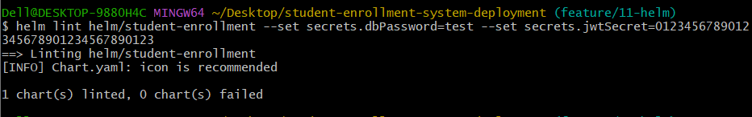
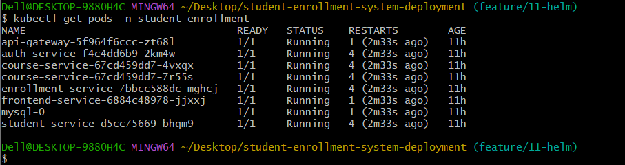
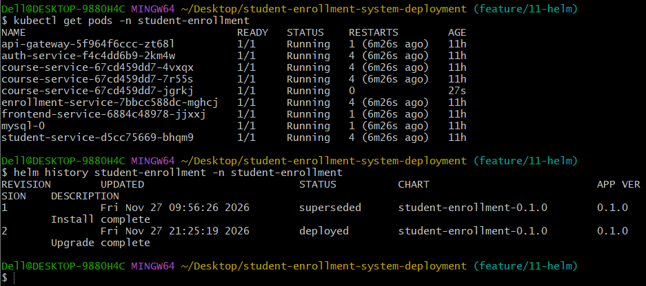
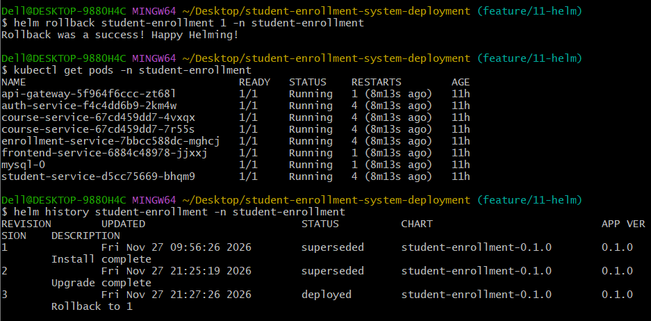

# Chart Helm (issue #11)

## Objectif
Remplacer les six fichiers `k8s/apps/*.yaml`, presque identiques, par un seul chart Helm qui déploie toute l'application (6 services, MySQL, ConfigMap, Secret, Ingress) avec une seule commande, sur Minikube comme sur AKS.

## Structure du chart
```
helm/student-enrollment/
  Chart.yaml
  values.yaml              # les 6 services, les sondes, les ressources, MySQL, l'Ingress
  values-minikube.yaml     # images locales
  values-aks.yaml          # images du registre ACR
  templates/
    deployment.yaml        # UN modèle, répété pour chaque service avec range
    service.yaml           # UN modèle, répété pour chaque service avec range
    configmap.yaml
    secret.yaml
    mysql.yaml
    ingress.yaml
    _helpers.tpl
    NOTES.txt
```

## Comment ça marche
- **Les 6 services** sont listés dans `values.yaml` : nom, image, port et nombre de réplicas (2 pour `course-service`, 1 pour les autres). `deployment.yaml` et `service.yaml` parcourent cette liste avec une boucle `range` et créent un Deployment et un Service par entrée. Ajouter un service revient à ajouter quelques lignes dans `values.yaml`.
- **Mots de passe** : ils ne sont pas dans le chart. `secret.yaml` les lit dans `--set secrets.dbPassword=...` et `--set secrets.jwtSecret=...`. Si l'un manque (ou si le secret JWT fait moins de 32 caractères), `helm install` s'arrête avec un message d'erreur.
- **Deux fichiers de valeurs** :
  - `values-minikube.yaml` : images locales `student-enrollment/<service>:dev` et `GATEWAY_URL=http://127.0.0.1` (le navigateur passe par `minikube tunnel`).
  - `values-aks.yaml` : images `<registre>.azurecr.io/student-enrollment/<service>:0.1.x` et `GATEWAY_URL` vide. Sur AKS, l'adresse n'est plus `127.0.0.1` : avec une valeur vide, le navigateur appelle la même adresse que le site, via l'Ingress. Le nom du registre est à remplacer quand il est connu.

## Vérification du chart
```
helm lint helm/student-enrollment --set secrets.dbPassword=<mot-de-passe> --set secrets.jwtSecret=<secret-32-caracteres>
```
Résultat : `1 chart(s) linted, 0 chart(s) failed` (seul avertissement : l'icône du chart est recommandée).



J'ai aussi comparé la sortie de `helm template` avec les fichiers écrits à la main : les Deployments, Services, la ConfigMap et MySQL sont identiques. Les seules différences viennent du Secret et de l'Ingress, que le chart ajoute.

## Installation sur Minikube
Les anciens déploiements ont d'abord été supprimés, puis le chart installé :
```
kubectl delete namespace student-enrollment
helm install student-enrollment helm/student-enrollment -n student-enrollment --create-namespace \
  -f helm/student-enrollment/values-minikube.yaml \
  --set secrets.dbPassword=<mot-de-passe> --set secrets.jwtSecret=<secret>
kubectl get pods -n student-enrollment
```
Résultat : `STATUS: deployed`, révision 1. Les 8 pods (7 pods de services, dont 2 pour `course-service`, plus `mysql-0`) sont `1/1 Running`.



## helm upgrade puis helm rollback
**Upgrade** : passage de `course-service` de 2 à 3 réplicas.
```
helm upgrade student-enrollment helm/student-enrollment -n student-enrollment \
  --reuse-values --set services.course-service.replicas=3
kubectl get pods -n student-enrollment
helm history student-enrollment -n student-enrollment
```
Résultat : un 3e pod `course-service` est créé et devient `1/1 Running` en une trentaine de secondes. L'historique contient deux révisions : la 1 (`superseded`) et la 2 (`deployed`, « Upgrade complete »). L'option `--reuse-values` conserve les mots de passe déjà enregistrés, sans avoir à les retaper.



**Rollback** : retour à la révision 1.
```
helm rollback student-enrollment 1 -n student-enrollment
kubectl get pods -n student-enrollment
helm history student-enrollment -n student-enrollment
```
Résultat : `Rollback was a success!`, `course-service` revient à 2 pods. L'historique compte maintenant trois révisions, la 3 (`deployed`) portant la description « Rollback to 1 » : Helm ne revient pas en arrière dans l'historique, il crée une nouvelle révision identique à la première.



## Erreurs rencontrées
| Erreur | Cause | Solution |
|---|---|---|
| `winget install Helm.Helm` : `WinHttpSendRequest: 12007` | winget a essayé de joindre la source `msstore`, injoignable depuis mon réseau. | Helm était disponible dans la source `winget` ; l'erreur n'empêchait pas son installation. |
| `helm.exe` : « Une stratégie de contrôle d'application a bloqué ce fichier » | Windows empêche l'exécution de `helm.exe` sur mon PC. | Helm exécuté dans un conteneur Docker (`alpine/helm`), relié au réseau de Minikube avec un fichier kubeconfig gardé hors du dépôt. |
| Dans le conteneur, Helm ne joignait pas le cluster (`127.0.0.1:<port>`) | Le kubeconfig désigne l'adresse `127.0.0.1`, qui n'est pas celle de Minikube vue depuis un conteneur. | Remplacement de l'adresse du serveur par `minikube ip` (`https://192.168.49.2:8443`). |
| `minikube status` : `dockerDesktopLinuxEngine ... introuvable` | Docker Desktop n'était pas lancé. | Lancer Docker Desktop, attendre l'icône verte, puis `minikube start`. |
| Services en `CrashLoopBackOff` juste après `helm install` (jusqu'à 4 redémarrages) | Les services qui utilisent MySQL démarrent en même temps que lui, et la base n'était pas encore prête à accepter leurs connexions. | Aucune action : après quelques redémarrages, tous les pods sont passés `1/1 Running` et sont restés stables. |

## Ce que j'ai appris
- **Un chart remplace des fichiers répétitifs par un modèle et des valeurs** : les 6 services sont décrits une seule fois, et les différences (images, adresse de l'API, nombre de réplicas) se règlent avec `values-minikube.yaml` ou `values-aks.yaml`.
- **Les secrets ne se mettent pas dans le chart** : on les passe avec `--set` à l'installation, et `--reuse-values` permet de les conserver lors d'un upgrade.
- **`helm upgrade` et `helm rollback` laissent une trace** : chaque changement crée une révision dans `helm history`, et le rollback en crée une nouvelle plutôt que d'effacer l'historique.
- **Des services qui dépendent d'une base de données peuvent redémarrer au premier lancement** : Kubernetes les relance tout seul jusqu'à ce que la base réponde.
