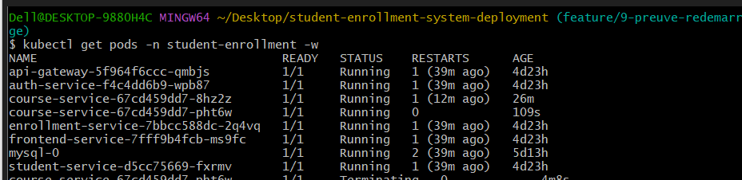
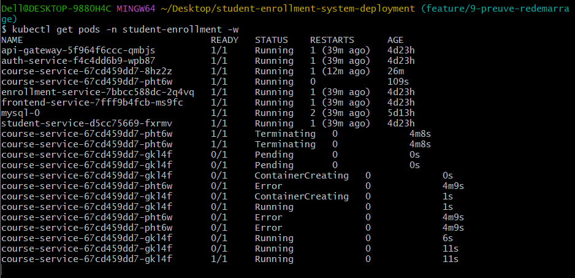
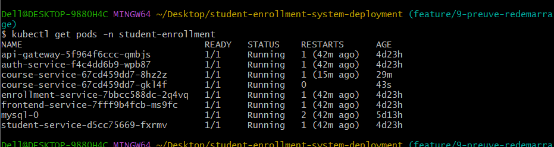
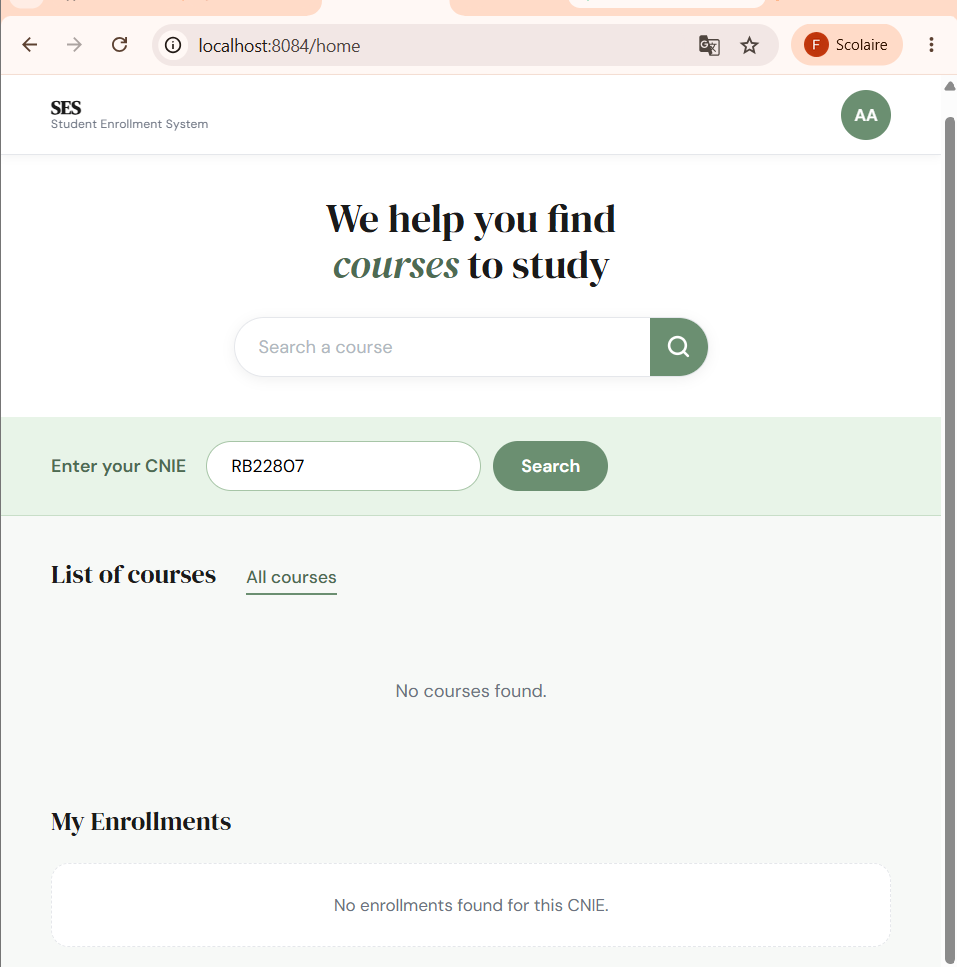
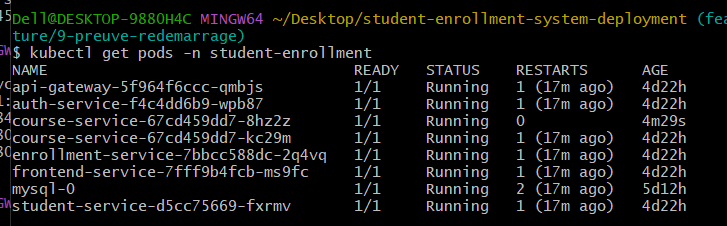
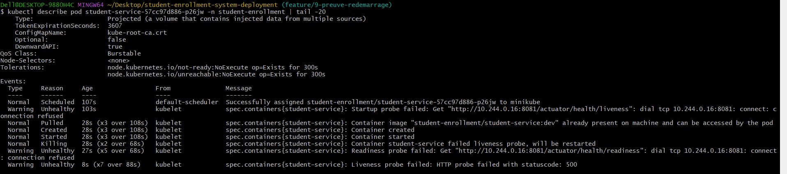
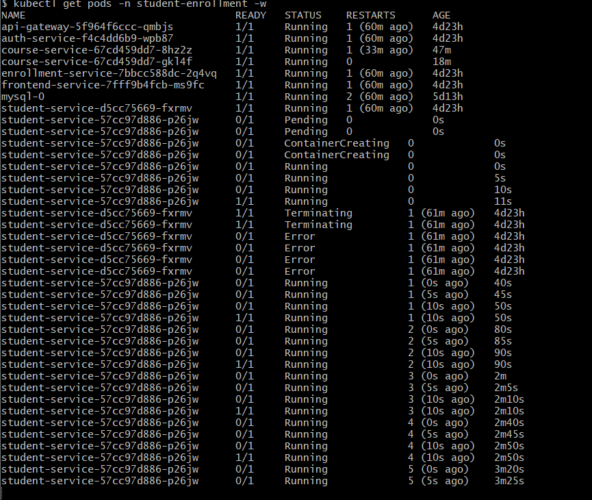
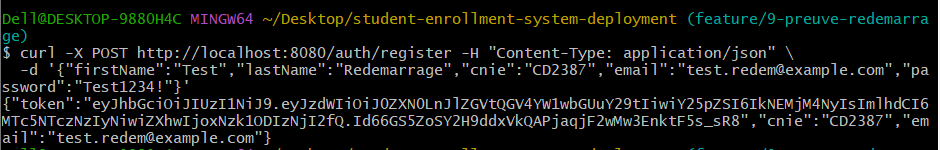

# Preuve de redémarrage sur Minikube (issue #9)

## Objectif
Montrer que Kubernetes répare tout seul l'application quand un pod est supprimé, quand un processus plante ou quand une sonde de santé échoue, et que les données de MySQL survivent à un redémarrage.

Dans chaque scénario, un 2e terminal suit les pods en direct avec `kubectl get pods -n student-enrollment -w`. L'application est accessible dans le navigateur grâce à deux `kubectl port-forward` (api-gateway sur 8080, frontend-service sur 8084).

## Scénario 1 : suppression d'un pod

**Commande**
```
kubectl delete pod course-service-67cd459dd7-pht6w -n student-enrollment
```

**Captures**

Avant : les deux pods de course-service tournent.



Pendant : l'ancien pod passe en `Terminating`, un nouveau apparaît en `Pending`, `ContainerCreating` puis `Running`.



Après : deux pods de course-service sont de nouveau `1/1 Running`.



L'application continue de répondre pendant le remplacement :



**Explication**
J'ai supprimé le pod `course-service-67cd459dd7-pht6w`. Le Deployment compare en permanence le nombre de pods voulus (2) au nombre de pods existants : il en manquait un, il a donc créé tout de suite `course-service-67cd459dd7-gkl4f`, prêt (`1/1`) en une dizaine de secondes. Pendant ce temps, l'autre réplica a continué de servir les requêtes, ce qui explique que la page des cours est restée accessible.

## Scénario 2 : plantage du processus

**Commande**
```
kubectl exec course-service-67cd459dd7-8hz2z -n student-enrollment -- kill 1
```

**Captures**

Avant : `RESTARTS` vaut 0.



Après : le pod est brièvement `0/1`, puis revient en `1/1 Running` avec `RESTARTS` à 1.


**Explication**
Le processus numéro 1 du conteneur est l'application Java elle-même. En le tuant, j'ai arrêté le conteneur, et Kubernetes l'a relancé dans le même pod : le pod n'a pas changé de nom, mais la colonne `RESTARTS` est passée de 0 à 1. Le pod était `0/1` pendant que l'application redémarrait, puis la sonde readiness est redevenue verte.

## Scénario 3 : sonde qui échoue

**Commandes**
Dans `k8s/apps/student-service.yaml`, j'ai remplacé le chemin de la `livenessProbe` par `/inexistant`, puis :
```
kubectl apply -f k8s/apps/student-service.yaml
kubectl describe pod student-service-57cc97d886-p26jw -n student-enrollment
```

**Captures**

Les événements du pod (section Events) : la sonde liveness échoue.



Le compteur `RESTARTS` augmente.



**Explication**
Le chemin `/inexistant` renvoie une erreur 404, donc la sonde liveness échoue. Après plusieurs échecs de suite (3 avec ma configuration), Kubernetes considère que le conteneur est défaillant : il affiche `Liveness probe failed`, puis tue et redémarre le conteneur, ce qui fait monter `RESTARTS`. Tant que le mauvais chemin reste en place, le cycle recommence. J'ai ensuite remis le chemin `/actuator/health/liveness` et réappliqué le fichier : le pod est redevenu stable en `1/1 Running`. Le mauvais chemin n'a jamais été commité.

## Scénario 4 : les données restent

**Commandes**
```
kubectl delete pod mysql-0 -n student-enrollment
kubectl get pods -n student-enrollment -w
```

**Captures**

Avant : un compte étudiant est créé.



Pendant : `mysql-0` est supprimé puis recréé.


Après : une fois `mysql-0` revenu en `1/1 Running`, l'étudiant est toujours là.


**Explication**
Les données de MySQL ne sont pas dans le pod, mais dans le volume persistant `mysql-data` (un PVC de 2 Gi). Quand j'ai supprimé `mysql-0`, le StatefulSet l'a recréé avec le même nom et lui a rattaché le même volume. MySQL a donc retrouvé ses fichiers, et le compte créé avant la suppression existait toujours après.

## Ce que j'ai appris
- Un Deployment maintient le nombre de pods voulu : si un pod disparaît, il en recrée un. Avec 2 réplicas, l'application reste disponible pendant ce temps.
- Quand le processus d'un conteneur s'arrête, Kubernetes redémarre le conteneur dans le même pod, et le compteur `RESTARTS` en garde la trace.
- La sonde liveness décide si un conteneur doit être redémarré, et la sonde readiness décide s'il reçoit du trafic.
- Pour qu'une base de données garde ses données, elles doivent être stockées sur un volume persistant et non dans le conteneur.
