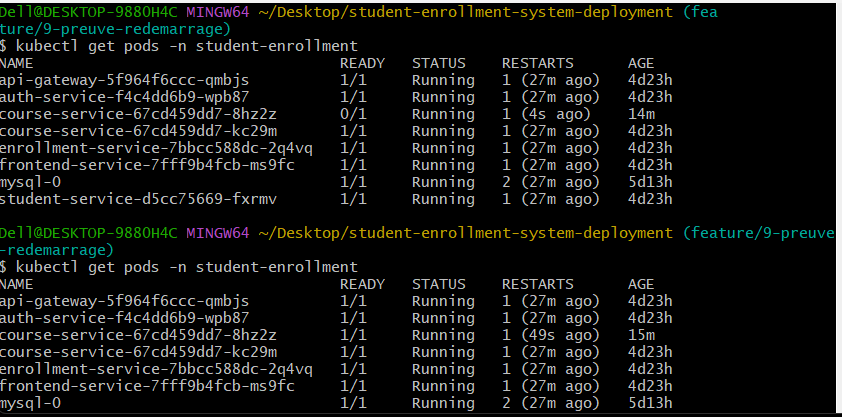
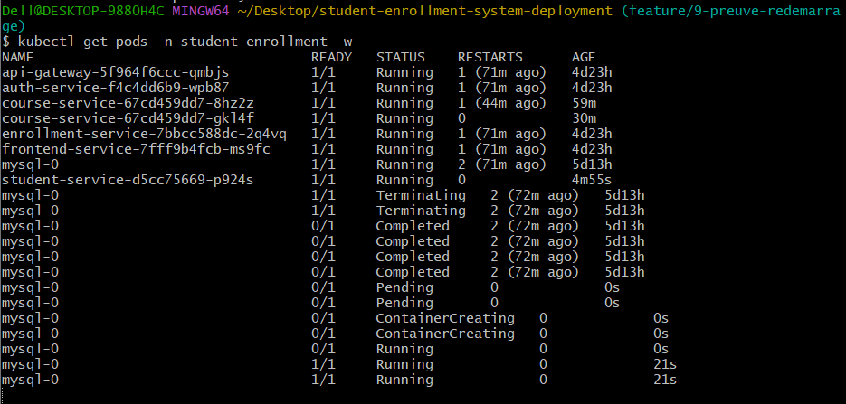
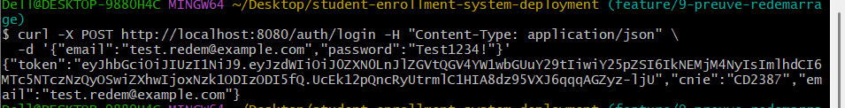

# Preuve de redémarrage sur Minikube (issue #9)

## Objectif
Montrer que Kubernetes répare tout seul l'application quand un pod tombe, quand un processus plante, quand une sonde échoue, et que les données de MySQL survivent à un redémarrage.

Dans tous les scénarios, un 2e terminal suit les pods en direct : `kubectl get pods -n student-enrollment -w`.

## Scénario 1 : suppression d'un pod
**Commande**
```
kubectl delete pod <pod-course-service> -n student-enrollment
```
**Captures**


**Explication**
J'ai supprimé un des deux pods de course-service. Le Deployment voit qu'il manque un réplica et en recrée un nouveau tout de suite. L'autre pod continue de répondre pendant ce temps, donc l'application ne s'arrête pas.

## Scénario 2 : plantage du processus
**Commande**
```
kubectl exec <pod> -n student-enrollment -- kill 1
```
**Captures**



**Explication**
Le processus 1 du conteneur est l'application Java. Quand je le tue, le conteneur s'arrête et Kubernetes le relance dans le même pod. La colonne RESTARTS passe de 0 à 1.

## Scénario 3 : sonde qui échoue
**Commande**
Dans `k8s/apps/<service>.yaml`, j'ai changé temporairement le chemin de la `livenessProbe` en `/inexistant`, puis :
```
kubectl apply -f k8s/apps/<service>.yaml
kubectl describe pod <pod> -n student-enrollment
```
**Captures**


**Explication**
Avec un chemin qui n'existe pas, la sonde liveness reçoit une erreur : « Liveness probe failed ». Après plusieurs échecs, Kubernetes considère que le conteneur est mort et le redémarre. J'ai ensuite remis le bon chemin `/actuator/health/liveness` et réappliqué le fichier.

## Scénario 4 : les données restent
**Commandes**
```
kubectl delete pod mysql-0 -n student-enrollment
kubectl get pods -n student-enrollment -w
```
**Captures**




**Explication**
J'ai créé un étudiant, puis supprimé le pod `mysql-0`. Le StatefulSet le recrée avec le même volume (le PVC `mysql-data`), donc les données ne sont pas perdues. Après le redémarrage, l'étudiant existe toujours.

## Ce que j'ai appris
(à écrire avec tes mots : 2 ou 3 phrases)
